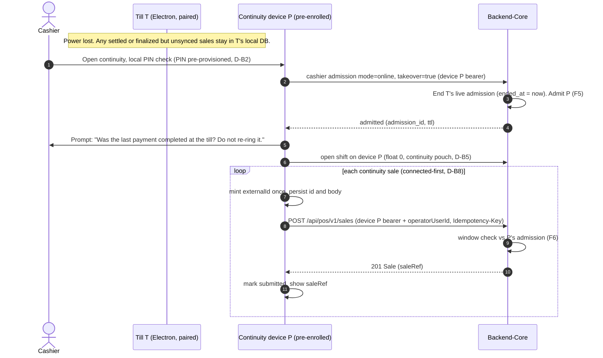
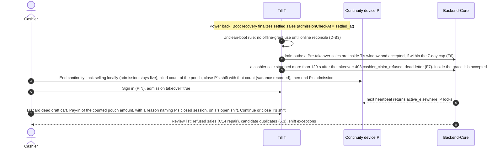

# RT-230 — Retail client continuity: thin/web client and mobile failover sales

**Status:** PROPOSED planning package. It is for owner review. Nothing here is approved, and it does not authorize implementation.
**Jira:** RT-230 (Epic, parent RT-7). Work Mode: **Planning**. Post-pilot. It is not a pilot blocker.
**Related:**
- RT-231 owns the mobile product architecture. This package supplies its Cashier Continuity decisions.
- RT-280 owns the Store Authority Lease.
- RT-295 owns Fiscal Device identity and the fiscal outbox.
- RT-113 (offline cashier continuation) and RT-224 (device-path cashier sale capture) are Done. RT-225 (`admissionCheckAt` plus a support reset for `cashier_claim_refused`) is In Review.
- RT-229 measures low-spec hardware.

**Baselines verified for this plan (2026-10-15):**
- `Kemetra/POS` `origin/main` `96895000`.
- `Kemetra/Backend-Core` `origin/main` `ddae78a7`.
- The Confluence pages cited in §2.

**What this package does not do:** it makes no API, DB or contract change and writes no code. Each Backend-Core need below is a **decision for the owner**, not a contract edit.

---

## 0. Summary

1. **The cheapest safe continuity path needs no new client.** A second Retail Terminal that is already paired, such as a spare laptop on battery, can carry on today. It uses the existing cashier-admission **takeover**. It opens its own shift, so its own cash location. Its sales are captured through its own outbox. The dead till's later cashier sales are already **fenced by the server's admission-window check**, except for a 120 s grace after the takeover (F7). Stage 0 proves the failover semantics on this setup in the lab before any phone or web client is built.
2. **Mobile continuity, if it is built, is connected-first.** It runs as a capability inside the RT-231 mobile app. The phone is its **own enrolled device** with its own credential, admission, shift and Cash Location. It never takes over the dead till's drawer. Bounded-offline phone selling waits for RT-280.
3. **Exactly-once covers replays, not re-rings.** The existing idempotency (`(tenant, sourceSystem, externalId)` plus `Idempotency-Key`) collapses retries of *the same* sale. It cannot detect a sale the dead till finalized locally that the cashier then **re-rings** on the phone, because those are two sales with two ids. The design therefore depends on three things:
   - **fresh sales only** on the continuity client, with no cart moving across devices;
   - a cashier prompt at handoff;
   - **a review of candidate duplicates at recovery** that operators can see and that never voids automatically.
4. **The thin/web client is deferred until RT-229 shows a need.** If it goes ahead, it is a connected-first browser client with no device token in browser storage. Its device trust is an open Backend-Core decision.

---

## 1. Intent and scope

**The question** (RT-230): when the Windows till is unavailable, for example after a power cut, can the same authorized cashier keep selling from an approved alternate device? And can the store then reconcile without duplicate sales, broken shift cash or unclear operator attribution? Separately, should a thin/web client exist for hardware that does not justify Electron?

**RT-230 owns these** (comment 10950):
- the Thin Web/PWA evaluation;
- cashier continuity;
- continuity session and device fencing;
- cross-device sale idempotency;
- shift, cash and tender behaviour during failover;
- recovery when the till returns.

**RT-230 does not own these:**
- **RT-231:** Manager Mobile, the Owner view, the mobile MVP, the role-capability matrix, shared mobile architecture and the technology choice. RT-230 states what Cashier Continuity *requires*; RT-231 decides *how the app delivers it*.
- **RT-280:** the lease model and offline grants for a Cash Location.
- **RT-295:** fiscal identity and the issuance chain.

**Constraints that are already fixed:**
- Electron stays the primary offline-capable POS.
- No Lite-Electron fork.
- Every client calls Backend-Core only, never ERPNext.
- No second financial authority.
- No card data in Retail Tower.
- Never reuse raw terminal credentials on another device.

---

## 2. Verified current state (the reuse foundation)

Each fact below was read on the baselines above. The design reuses these mechanisms rather than adding parallel ones.

| # | Fact | Where |
|---|---|---|
| F1 | A sale is finalized in one atomic transaction. It is durable before printing, and the same transaction enqueues it to an outbox. The drain engine POSTs it to `POST /api/pos/v1/sales`. | POS `docs/architecture/current.md` §4–5; `src/main/sync-outbox/`, `src/main/sales-sync/` |
| F2 | `externalId = "pos-pulse:" + envelope_handoff_action_id`. That id is the one-sale-per-handoff anchor, and it has a unique index. The body is decided once, so every retry sends identical bytes. | POS `src/main/sales-sync/capture-payload.ts:251` |
| F3 | Backend-Core dedups on `(tenant, sourceSystem, externalId)`. A same-key retry gets 201 replayed. A provenance replay under a new key gets 200 with the same Sale. A different payload is 409 `idempotency_key_conflict`, which the POS dead-letters as `divergent`. An in-flight duplicate is 425 with `Retry-After`. Keys live 72 h. | BC `packages/contracts/openapi/pos-sales/sales.yaml` 1.7.0-draft; POS `current.md` §5 |
| F4 | `sourceSystem` is a free string (1–100 characters). It is **not bound to the calling credential** (zod `z.string()`), and the schema calls it "not body-assignable authority". | BC `catalog/sales/dto/capture-sale-request.dto.ts:129` |
| F5 | **The single-active rule for cashiers** allows at most one live admission per `(tenant, store, user)`. If another device holds it, a cashier sign-in gets `active_elsewhere`, unless the request is an online `takeover: true`. A takeover ends the other device's admission and is rate-limited and audited. `reconcile_offline` never supersedes a live admission: the server wins. | BC `pos-cashier-admissions.openapi.yaml` 1.1.0-draft |
| F6 | **Device-path cashier capture** (RT-224) uses the device bearer plus `operatorUserId`. A sale is accepted only if an admission row for **the same device and user** has a window that covers `admissionCheckAt ?? occurredAt`: `created_at − 120 s ≤ t < LEAST(ended_at, expires_at) + 120 s`. Ended and expired rows still count *inside* their windows. **Back-dating cap:** the covering window must have ended at most `MAX_WINDOW_AGE_SECONDS` = **7 days** before the server's now. | BC `catalog/sales/operator-attribution.ts` header |
| F7 | One consequence of F5 and F6 is that **fencing already exists on the cashier path**. After a takeover, the till's admission has `ended_at` set. A later cashier sale from that till is refused with 403 `cashier_claim_refused` **only when its check time is more than 120 s after `ended_at`**. A sale stamped inside that 120 s grace is still accepted, so the fence is not hard at the takeover instant. A refused sale is dead-lettered by the POS. **RT-225 cannot repair it**: its support reset (`src/main/sales-sync/cashier-claim-refused-reset.ts`) re-sends the same device-path submission, which is outside the window and is refused again. POS has a manager-envelope repair for shift facts (`buildEnvelopeRepairRequest`), but none for sales. Such a sale needs the manager-authorized repair path (C14), which does not exist yet. Sales from *before* the takeover are still accepted. | F5 + F6 |
| F8 | **The manager-envelope path has no admission window.** A stale manager or admin sale from a returning till is *not* fenced by F7. | BC `sales.yaml` (`operatorAuthorization` path); POS `current.md` §6 |
| F9 | **Offline grant (RT-113):** a sealed, per-terminal proof of an earlier online admission. Limits: at most 72 h (server default 24 h), at most 8 uses, a clock high-water mark, and a pairing epoch. It is local to the device and cannot move to another device. | POS `src/main/operator/offline-grant-store.ts` |
| F10 | Cashier PIN records are **per terminal**, keyed by `(tenant, branch, terminal, user_id)`. A manager provisions them on that terminal (spec 019, RT-235). A new device has no PIN for any cashier until one is provisioned there. | POS spec 017/019; `pin-management.ts` |
| F11 | Shifts allow **at most one open shift per device** (`shift_already_open`). Under V1, one POS device is roughly one logical Cash Location. Shift facts carry their idempotency key and body when stored, and the device path carries `operatorUserId`. A forced close is manager-envelope only, and the POS does not build one. | BC `pos-shifts.openapi.yaml` 1.1.0-draft; POS `src/main/shift-cashup/shift-wire.ts` |
| F12 | The only sale read route is `GET /api/pos/v1/sales/:saleRef`, keyed by the server's sale reference. **There is no lookup by `(sourceSystem, externalId)`.** | BC `catalog/sales/sales.controller.ts` |
| F13 | **RT-138 target (not all on main):** re-pairing creates a new device row and a new `terminal_id`, and the old outbox is never replayed under the new identity. Revoking a device is immediate and also ends its sessions. On main the only device route is `POST /api/pos/v1/terminals/pair` (see G3). | Confluence Device Registry page 23887876; BC `pos-terminal-pairing/pairing.controller.ts:57` |
| F14 | **Gaps that RT-231 reported** (shared note, BC `ddae78a7`; G1/G2 not re-verified here; **G3 re-verified**: `pairing.controller.ts` exposes only `pair`): **G1**, no human bearer is minted, only the `dp2_session` cookie; **G2**, an `Origin` check refuses cookie POSTs from a native app; **G3**, main has only `POST /api/pos/v1/terminals/pair`, with no pairing-code issue, device list or revoke routes. | sibling note `RT-231-mobile-auth-gap.md` |

**Confluence decisions this package must respect:**
- **Shift & Cash 1683–1707:** one authoritative offline writer per Cash Location. Mobile continuity cash must "prove fencing or use a distinct continuity Cash Location / cashless mode". Late sync stays in its original Cash Session.
- **Shift & Cash 1626–1666:** never fabricate a count. A forced seal records the count as unknown.
- **Payment:** no offline card authorization, and offline credit is never automatic.
- **Fiscal 1164/1165/1177/1180–1182:** a Terminal is not a Fiscal Device. Re-pairing must not silently create a Fiscal Device. Each device has its own fiscal outbox.
- **Inventory 867/868:** selling batch- or serial-tracked items needs a connection.
- **Org 242–246:** offline selling runs on a Store Authority Lease (RT-280).
- **Device page:** pairing is enrollment, not sign-in, and a drawer actuator is not a Cash Location.

---

## 3. Continuity scenarios

| # | Scenario | Network | What must hold |
|---|---|---|---|
| S1 | The till loses power **between sales**. Store internet works, or the alternate device has cellular. | Up | The cashier continues on the alternate device, and no sale is lost or duplicated. |
| S2 | The till loses power **mid-cart**, before payment. | Up | The cart is not moved. The alternate device starts a fresh sale, and the dead cart is discarded when the till returns. |
| S3 | The till loses power **after settlement but before finalization**, so payment was taken. | Up | On return, boot recovery finalizes the sale with `admissionCheckAt` = settled time, which is inside the old window, so it is accepted **if the till returns within 7 days of that window ending** (F6 cap). After that the sale is refused and needs the manager-authorized repair path (C14), which does not exist yet. If the cashier re-rang it on the alternate device, that pair is a **candidate duplicate** (§6.3). |
| S4 | The till loses power **after finalization but before the sale synced**. | Up | The sale syncs when the till returns (its `occurredAt` is inside the old window), subject to the same 7-day cap. A re-ring is again a candidate duplicate. |
| S5 | The till returns **while continuity is active** and is online. | Up | The till sees `active_elsewhere` on its next heartbeat and locks. Its cashier sales from more than 120 s after the takeover would be refused (F7). There is an explicit handback. |
| S6 | The till returns **while the store is offline**. The power cut also took the router down. | Down at till | The till might run on its offline grant (F9). Any cashier sale it makes outside the 120 s grace is refused when it syncs (F7). It dead-letters, is visible to operators and needs the manager-authorized repair path (C14), which does not exist yet. This is a **gap to close** (D-B3, Risk R2). |
| S7 | The till **never returns** because the hardware is dead. | n/a | The till's open shift needs a manager-driven forced seal with the count *unknown*. Its unsynced outbox is lost unless the disk can be recovered. Sales from a recovered disk that arrive more than 7 days after the window ended are refused (F6 cap) and need the manager-authorized repair path (C14), which does not exist yet. Its device is revoked and re-enrolled (F13). |
| S8 | The alternate device **crashes or loses signal between POST and response**. | Flaky | The same `externalId` and the same body must be retried. A fresh id would create a second sale. |
| S9 | The continuity device is **lost or stolen**. | Any | Revoke it immediately, which ends its sessions. Its continuity shift becomes a cash exception, and the count is unknown. |
| S10 | A store has **no alternate device enrolled** when the outage happens. | Any | Continuity is not available. The fallback is a paper record and later entry (§10, D-B9). Enrolling during an outage is not a supported path. |

---

## 4. Approaches considered (architecture level)

**A. Stage 0, a backup Retail Terminal (recommended first step).**
- **How it works:** a spare Windows laptop or second till is paired in advance as its own terminal, kept charged and ready to sell. Failover uses the existing cashier takeover.
- **What it reuses:** the full offline outbox, its own shift as its own Cash Location, the existing printer and drawer stack (when attached), and existing idempotency.
- **Cost:** no new contracts and no new client.
- **What it gives up:** a phone form factor. It needs a second Windows machine.
- **Why first:** it answers every *semantic* question in this package (fencing, cash split, duplicate review, handback) with code that already ships. A lab Verification issue can prove that.

**B. Continuity as a capability of the RT-231 mobile app (recommended target).**
- **How it works:** a connected-first phone surface on the same shared mobile core: auth, device trust, secure storage and API client.
- **Cost:** it depends on the RT-231 technology gate and on gaps G1–G3 (F14).
- **What it gives up:** offline selling and native printer/drawer use.

**C. One connected-first web client that serves both thin counters and phone continuity.**
- **Appeal:** one client covers two use cases.
- **Main weakness:** a browser has no `safeStorage` or hardware-backed key by default. It cannot safely hold a device credential, and the device-path cashier capture (F6) depends on one. It would need WebAuthn- or DPoP-style device binding, which is a new security contract.
- **Recommendation:** not recommended as the continuity vehicle. It stays an option for Track A only.

**Recommendation:** A, then B. Keep C only as a separate Track A option, gated by RT-229.

---

## 5. Track A — Thin/Web client

### 5.1 Who it is for

| Candidate | Fits? |
|---|---|
| A low-volume secondary counter on customer-owned hardware below the RT-229 minimum | Yes, if RT-229 finds such hardware is common. |
| Back-office sale entry, for example re-entering paper sales recorded during an outage | Yes. It is connected-first by nature. |
| The primary cashier at a busy pharmacy | **No.** It needs offline durability, a drawer and fast scanning. Use Electron. |
| Emergency continuity on a phone | **No.** Use Approach B (device trust, §4). |

### 5.2 What it gives up compared with Electron

| Capability | Electron POS | Thin web |
|---|---|---|
| Offline sale and outbox | Yes (F1, F9) | **None.** A sale is complete only after Backend-Core returns 201/200. A browser has no single-instance lock or trusted durable store, so there is no IndexedDB outbox. |
| Device credential | Device token in DPAPI `safeStorage` | **Never stored in browser storage.** Needs a new device-binding decision (C7). |
| Scanner | HID or keyboard wedge | HID keyboard wedge works. Camera scanning is optional later. |
| Receipt printing | Silent ESC/POS or OS print to a known printer | Browser print dialog only. No silent print. |
| Cash drawer kick | Yes | **No.** Cash needs a manual drawer, otherwise sales are cashless. |
| Catalogue | Full local snapshot (read-down) | Online lookup and search (C8). An optional bounded cache helps speed but is never authority. |
| Tenders | cash, `card_external`, voucher (online) | `card_external` (standalone PSP terminal), and cash only if a drawer is present. No vouchers, credit or insurance in v1. |
| Updates | Signed installer and auto-update | Server-deployed, so it is always current. That simplifies compliance. |
| Peripherals and fiscal | Per-device adapters | None in v1. Fiscal depends on RT-295. |

### 5.3 What must be shared and what is client-specific

| Shared, owned by Backend-Core | Client-specific |
|---|---|
| Sale capture contract and idempotency | UI shell |
| Admissions and the single-active rule | Peripheral adapters |
| Shifts | Local durability, which only Electron has |
| Catalogue resolution | |
| Audit | |

Do **not** extract an "Electron-lite" from the POS renderer. The POS renderer's trust model assumes a main process (Constitution III).

### 5.4 Decision A1 — whether to build a thin/web client

- **Options:**
  - (a) defer until RT-229 evidence shows real hardware that cannot run Electron;
  - (b) plan it now as a back-office sale-entry tool;
  - (c) build it as a full cashier client.
- **Recommendation: (a).** Re-evaluate with RT-229's Minimum Supported result. If evidence later justifies it, start with (b), which needs no device trust if it runs under a manager or admin human session, and is the smallest safe scope.
- **Consequence:** Track A creates no contract work now.

---

## 6. Track B — Mobile (alternate-device) continuity

Each block uses an ADR shape: **Decision**, options, **recommendation**, rationale, consequences.

### D-B1 — Device identity of the continuity client

- **Options:**
  - (a) an **enrolled device of its own** in the Device Registry, with its own credential and `terminal_id`, enrolled **before** any outage;
  - (b) reuse the till's identity or token on the phone;
  - (c) pair it during the outage.
- **Recommendation: (a).**
  - (b) is forbidden: the decisions forbid reusing raw terminal credentials.
  - (c) is unrealistic during a power cut and is blocked by gap G3 (no route to issue pairing codes or revoke devices on main).
- **Consequences:**
  - The phone gets its own admission, shift, Cash Location and (later) fiscal identity.
  - Sales carry the **phone's** `terminalId`, which makes attribution honest.
  - Phones are store-owned devices only. No personal devices in v1.
  - **Dependency:** the device-enrollment and device-class decisions shared with RT-231 (C1).

### D-B2 — Cashier identity and session handoff

- **Options:**
  - (a) a local PIN check on the continuity device, then the **existing online admission with `takeover: true`**;
  - (b) a new server-side "continuity session" type that a manager pre-authorizes;
  - (c) a manager signs in on the phone and attests the cashier.
- **Recommendation: (a)**, with two conditions:
  - PINs are **pre-provisioned on the continuity device** by a manager, so the handoff itself needs no new credential type. **That provisioning path does not exist for a phone yet.** Today's `provisionCashierPin` is Electron-local: it needs a current manager or admin session on that terminal and writes that terminal's local database (F10). A phone needs a mobile provisioning workflow in which a manager authenticates on the phone and creates its first cashier PIN records: through C13 (a human credential for native mobile) or another manager-authorized enrollment path. It is a prerequisite for Stage 3.
  - Enrolling the device counts as the store's authorization of it as a continuity device.
- **Rationale:** the takeover is already serialized, rate-limited and audited (F5). It ends the till's admission, which is exactly the fence F7 relies on.
- **Consequences:**
  - No new session concept.
  - A manager alert ("cashier X took over on continuity device Y"), delivered through RT-231 alerts, is a later addition, not a gate.
  - **Open question for the RT-231 technology gate:** a non-Electron client must re-implement local PIN-record storage in secure storage. If that is unacceptable, (b) becomes the fallback and needs a contract (C3).

### D-B3 — Fencing the stale till

The cashier path is **already fenced server-side** (F7). Two gaps remain.

- **Gap 0, the 120 s grace after a takeover (F7).** A stale till sale stamped inside the grace is accepted.
  - Options: (a) review it, by extending the candidate-duplicate scan to takeover + 120 s (§6.3); (b) a hard server fence that removes the grace for an admission ended by a takeover (part of C6).
  - Recommendation: (a) now; decide (b) with C6. Stage 0 tests the boundary.
- **Gap 1, the manager-envelope path (F8).** A manager or admin sale from a returning till has no admission window.
  - Recommendation: give continuity mode a **"continuity active for till T" device fence state** (C6). The manager-envelope path refuses that device's sales while the fence is up. Alternatively, the policy is that a manager never sells on a fenced till until handback.
  - The server fence is preferred. It is a contract decision.
- **Gap 2, a returning till that is offline (S6).** The till can resume on its offline grant (F9) and ring sales that are certain to be refused later.
  - Options:
    - (a) after an **unclean shutdown**, the POS suspends offline-grant use until one online reconcile succeeds;
    - (b) accept refusal and the manager-authorized repair (C14);
    - (c) do nothing.
  - **Recommendation: (a).** It needs no Backend-Core contract change. However, **the POS does not know today that its last shutdown was unclean.** The boot recovery scans run on every launch, and there is no persisted clean-shutdown or dirty-boot marker on the baseline. The rule therefore needs a new, reliable lifecycle signal: a marker set at start, cleared on an orderly quit, and read at the next boot. Without it, the rule would either suspend grants after every restart or never fire. However, it **amends an owner-decided RT-113 behaviour**, offline continuation on a valid grant. It therefore needs an explicit owner ruling as an RT-113 amendment. An agent must not quietly redefine it.
  - **Trade-off:** a till that loses power while the whole store is offline, with no continuity device, also loses offline selling after the reboot. The owner must weigh this (Risk R2). A narrower form: suspend only when the store has a continuity device enrolled, which requires the till to know that (C6).

### D-B4 — Sale state across devices

- **Decision:** **fresh sales only** on the continuity device. No cart moves between devices. Park and Resume (RT-440) stays local to the device.
- **Rationale:** a cart on a dead till cannot be read. Inventing a cart transfer would also create a second authority for an unfinished sale.
- **Consequences:**
  - The dead till's open cart stays a local draft. When the till returns, the handback flow requires discarding it, so it is never finalized implicitly.
  - Boot recovery still finalizes *settled* sales (S3), because payment was taken.
  - At handoff the continuity client asks the cashier: *"Was the last customer's payment completed at the till (cash taken, card approved, receipt printed)? If yes, do not ring it again."* This is the main defence against the duplicate in §6.3.

### D-B5 — Shift and cash

**What the existing rule already gives:** a shift allows at most one open shift per device (F11), so a phone that is its own device (D-B1) already has **its own Cash Session**. Under V1 that is a **distinct continuity Cash Location**. This meets Shift & Cash 1683–1707 without a takeover of the till's drawer.

**Options for cash on the continuity device:**
- (a) **allow cash into the continuity Cash Location**: the phone's own shift opens with a float of 0 (a "cash pouch"), and the handback closes it with a blind count;
- (b) **cashless only**: only `card_external`;
- (c) take over the till's Cash Location (rejected: there is no fencing proof, and the drawer stays physically at the till).

**Recommendation: (a), with (b) available as a store policy switch.** Most Egyptian pharmacy sales are cash, so a cashless-only continuity mode would rarely help.

**Moving the cash at handback:** until internal transfers exist (Shift & Cash deferred), physical cash moves from the pouch to the till by closing the phone's shift on its blind count, then recording a pay-in of the counted amount on the till's open shift once the cashier is back on the till. There is no pay-out on the phone. A pay-out cannot exceed expected cash, so an over pouch could not be moved, and paying out the expected amount would hide the variance. A cash movement is accepted only on an open shift (`shift_not_open` locally, `shift_closed` from Backend-Core), and the till's shift is open. The pay-in uses a structured reason. Whether a dedicated reason code is needed is decision C9.

**The dead till's shift:**
- It stays open, and no fact is fabricated.
- If the till returns, the cashier closes it normally with a count; the drawer cash is still there.
- If the till never returns (S7), a manager force-seals it with the **count unknown**. That needs a forced-seal and recovery-count path outside the dead POS (C10). Today a forced close is manager-envelope only and is built by no client.

### D-B6 — Payments

- **Allowed:** cash (to the continuity Cash Location, D-B5) and `card_external` (a standalone PSP terminal; Retail Tower records only method and amount, with no card data and no reference, per RT-79 D-A).
- **Not allowed in continuity v1:** vouchers, store credit or any credit, insurance or copay, returns, refunds and voids. Those go back to the till or to a manager after recovery.
- **Rationale:** each excluded tender brings its own authority flow. Continuity should be the smallest safe sale.

### D-B7 — Receipts and peripherals

- **No dependency** on the Windows printer, scanner or drawer.
- **v1:** an on-screen confirmation with the server `saleRef`. Camera barcode scanning or a Bluetooth HID scanner is optional, and is an RT-231 technology-gate item.
- **Later:** a digital receipt as a link or QR code (C11), or a reprint from the till or Admin Console. "Today's invoices" is a separate idea and is not built.
- Printing and drawer kick are **not** part of the continuity contract.

### D-B8 — Connectivity

- **Options:**
  - (a) **connected-first**: a sale is shown as complete only after Backend-Core answers 201/200;
  - (b) bounded offline on the phone.
- **Recommendation: (a).** (b) creates a second offline writer and needs its own lease and grant model (RT-280), per-device fiscal issuance (RT-295) and an offline Cash Location. Revisit it after RT-280.
- **Consequences:**
  - A power cut that also takes down store internet still allows continuity over **cellular data**.
  - "Connected-first" still needs a **small durable store for submissions whose result is unknown**. The client writes `externalId` and the exact body *before* the first POST, and it retries with the same key until it gets 201, 200 or a definite refusal (S8, F3).
  - The client mints `externalId` once when the sale is created: UUIDv7, namespaced, with a `sourceSystem` per client class (C2).
  - Because no lookup by provenance exists (F12), this durable record is **required, not optional**. The alternative is a new read (C4).
  - **The same durable-before-POST rule applies to every shift fact** (open, cash movement, close) and to the admission `end`. The client decides each fact's natural id, body and Idempotency-Key once, stores them, and replays exactly those bytes after a crash or a lost response. This is the Electron POS pattern in `src/main/shift-cashup/shift-wire.ts`. Minting a new id after a restart could return `shift_already_open`, or leave the client unable to tell whether the handback close landed.

### D-B9 — Recovery and handback

The ordered handback:
0. **Lock selling before counting.** "End continuity" first locks selling on the phone locally. A closed shift alone does not stop selling, because the current client treats a missing open shift as advisory. The phone **keeps its admission live** for now: a device-path shift close is valid only while `closedAt` is inside the cashier's admission window (`pos-shifts.openapi.yaml`, same 120 s rule as F6). Ending the admission first would strand the shift open whenever the count takes longer than 120 s.
1. On the phone: blind-count the pouch and **close the phone's shift with that count**, as in any normal close. Variance = counted − expected is recorded faithfully, whether it is short or over.
2. **No pay-out on the phone.** A pay-out of the counted amount would be refused whenever the pouch is over (`pay_out_exceeds_drawer_cash`, `src/main/shift-cashup/shift-cashup-service.ts`). A pay-out of the expected amount would hide the overage.
3. Physically move the counted cash to the till. Removing cash from a closed location is the same situation as a closed drawer emptied to the safe today. The paired out/in record is the deferred internal-transfer capability, so the interim record is the till-side pay-in (step 6).
4. Only after the close: the phone ends its cashier admission with the existing admission `end`. Alternatively, the cashier's takeover on the till ends it. The cashier signs in on the till with `takeover: true`, and the phone gets `active_elsewhere` on its next heartbeat. A phone sale after this point is refused server-side once beyond the 120 s grace (F6).
5. The till discards any dead draft cart.
6. On the till's open shift, record a pay-in of the counted amount, with a structured reason that names the closed continuity session (C9).
7. The till drains its outbox.
8. Close or continue the till's own shift.
9. Review the operator-visible items:
   - dead-lettered `cashier_claim_refused` sales from the till (F7), which need the manager-authorized repair path (C14), which does not exist yet;
   - **candidate duplicates** (§6.3);
   - shift exceptions.

**S10 has no alternate device.** The store keeps a paper record, and a manager enters those sales afterwards, on the till or later on a back-office client (Track A (b)). Paper entries get their own `externalId` from their entry device. They are never backdated into the dead till's identity.

### D-B10 — Security

- Store-owned, pre-enrolled devices only.
- The credential lives in platform secure storage (Keystore or Keychain), never in plain storage.
- **Immediate revoke** on loss (F13), which also ends sessions and admissions. Cash recovery never delays the revoke.
- Its continuity shift then becomes a cash exception with the count unknown.
- PIN records on the phone follow the same lockout and purge rules as the POS (spec 017/019).
- Never reuse a till token. Never send a PIN, token or card data over the wire or into logs.
- Every continuity action is audited with actor, device and store (RT-135 envelope).

### 6.1 Sequence — power loss and handoff

### 6.2 Sequence — the till returns (recovery)

### 6.3 The sale and idempotency model, stated honestly

| Duplicate kind | Caught by | Status |
|---|---|---|
| A retry of the same sale from the same device (timeout, crash, 425) | `(tenant, sourceSystem, externalId)` plus `Idempotency-Key` (F3), and a durable `externalId` written before the POST (D-B8) | **Covered** by existing semantics. |
| The same body sent twice under a new key | Provenance replay, 200 (F3) | **Covered.** |
| A changed body under the same id | 409 divergence, dead-letter (F3) | **Covered** (fails closed). |
| A stale till ringing new cashier sales after the takeover | Admission window (F6/F7) | **Fenced beyond 120 s.** Those sales dead-letter, are visible to operators and need the C14 repair. Inside the grace they are accepted and are reviewed as candidates (below). |
| A stale till ringing manager sales after the takeover | Nothing today (F8) | **Gap:** C6. |
| **A sale finalized on the dead till that the cashier re-rang on the phone** | Nothing can catch it: two real sales with two ids | **A business duplicate. Mitigated, not prevented.** |

Mitigation for the last row:
1. The handoff prompt (D-B4).
2. A **review list of candidate duplicates at recovery** (C5). It pairs each till sale with `occurredAt` in the window [takeover − N min, takeover + 120 s] with any continuity sale in [takeover, takeover + N min] that has the same cashier, the same store, the same total and the same multiset of lines.
3. The list is for operator review only and **never auto-voids**. A manager resolves a pair through the existing void or return flow, with audit.

**"Exactly-once" is claimed only for the first four rows.**

---

## 7. Connectivity statement (what needs a connection)

| Capability | Electron POS (today) | Continuity device | Thin web |
|---|---|---|---|
| Sign-in / admission | Online, or the RT-113 offline grant | **Online** (takeover) | Online |
| Ring and finalize a sale | Offline-capable | **Online** (201/200 before "complete") | Online |
| Catalogue lookup | Offline (snapshot) | Online, or a snapshot cache that is never authority (C8) | Online |
| Cash tender | Offline (own drawer) | Online, to its own continuity Cash Location | Online, and only with a drawer |
| `card_external` | Offline record | Online record | Online record |
| Vouchers | Online | Not available | Not available |
| Batch- or serial-tracked items | Online-required (867/868) | Online-required | Online-required |
| Open or close shift | Offline-capable, then syncs | Online | Online |
| Takeover / handback | Online | Online | n/a |
| Returns, voids, refunds | Per existing flows | Not available (D-B6) | Not available |
| Fiscal issuance | Depends on RT-295 | **Blocked until RT-295** | Blocked until RT-295 |

---

## 8. Backend-Core contract needs, as decisions only (no edits)

| # | Decision needed | Why | Recommendation | Shares RT-231 gap? |
|---|---|---|---|---|
| C1 | **Device enrollment for non-Electron clients.** A device class or kind (`retail_terminal`, `continuity_device`, `web_client`) with a capability limit for each class: no offline grant, no drawer. | D-B1. Pairing exists, but the issue, list and revoke routes do not (G3). | Reuse the Device Registry. Add a device class rather than a new registry. | **Yes, G3.** Use one decision for both. |
| C2 | **`sourceSystem` bound to the credential.** The server derives or validates `sourceSystem` from the device class instead of trusting the body (F4). | Without it, any client could claim `pos-pulse` and collide on the dedup key. | Server-validated, one value per client class. | No |
| C3 | **A continuity session type pre-authorized by a manager.** | Only if D-B2(a) fails at the RT-231 technology gate. | Not needed unless that happens. | Partly (auth model) |
| C4 | **A sale lookup by provenance** (`(sourceSystem, externalId)` → Sale). | Lets a client recover a submission whose result is unknown without a durable record (F12). | Not needed if the client persists before POST (D-B8). Keep as an option. | No |
| C5 | **Candidate-duplicate attention item** at recovery (§6.3): a read model plus an Admin or Mobile surface. | The only mitigation for re-rung sales. | A Backend-Core projection over captured sales, never an automatic action. | Surface overlaps RT-231 alerts |
| C6 | **A fence state "continuity active for device T"** that the manager-envelope capture path refuses, and that the returning till can read. | Closes F8, and the narrow form of D-B3 Gap 2. | Recommended. | No |
| C7 | **Device binding for a browser client** (WebAuthn or DPoP style). | Track A only. A browser cannot hold a device token. | Defer with A1. | Related to G1/G2 |
| C8 | **Online catalogue lookup and search** for clients that cannot hold a full snapshot. | Thin web, and possibly the phone. | Decide after the RT-231 tech gate. The phone may just use the existing read-down snapshot. | Possibly |
| C9 | **Reason code for the till pay-in of continuity cash**, naming the closed continuity session, until internal transfers exist. | D-B5 handback. | Reuse an existing pay-in/pay-out reason if one fits. Otherwise add one, which is a small contract change. | No |
| C10 | **Forced seal and recovery count from outside the dead device** (Admin Console or Manager Mobile, manager envelope). | S7. The POS builds no forced close today (F11). | Needed before continuity is production-ready. | Overlaps RT-18 and RT-231 manager actions |
| C11 | **A digital receipt view** (link or QR, scoped by token). | D-B7, later. | Defer. | No |
| C12 | **Fiscal identity for continuity devices.** | RT-295 1164/1165/1180–1182. | Continuity is disabled in fiscal-enabled stores until RT-295 decides. | No |
| C13 | **Human credential for native mobile** (G1/G2), or another manager-authorized enrollment path. | Cashier selling on the device path does not need it. However, **a manager must authenticate on the phone to provision its first cashier PINs** (D-B2), and no such path exists today. | Required for Stage 3. Follow RT-231's decision on the mechanism. | **Yes, G1/G2.** |
| C14 | **Manager-authorized repair for refused cashier sales.** It covers sales outside the window, after the 7-day cap, or from a fenced till: a manager-envelope re-send of the stored sale, like the shift-fact repair, or a Backend-Core repair or import route. It must stay explicit and audited, and it must pass the C6 fence as a flagged repair, not as plain manager capture. | F7: RT-225's reset cannot authorize these. Without it, sales that were paid stay dead-lettered permanently. | Required before continuity is enabled. | No |

---

## 9. Risks

| # | Risk | Severity | Mitigation |
|---|---|---|---|
| R1 | A re-rung sale double-charges a customer (§6.3). | High | Handoff prompt, candidate-duplicate review (C5), fresh-sale-only rule. |
| R2 | The unclean-boot rule (D-B3a) removes offline selling from a till after a store-wide outage. | Medium | The owner chooses the broad or narrow rule. The narrow rule needs C6. |
| R3 | A manager sale on a returning till is not fenced (F8). | Medium | C6, or a policy of no manager selling on a fenced till. |
| R4 | No continuity device is enrolled when the outage happens (S10). | Medium | An enrollment checklist at store onboarding. Paper fallback. |
| R5 | A non-Electron client re-implements PIN storage weakly. | High | RT-231 technology gate. Security review. Fallback to C3. |
| R6 | Dead-lettered refused sales pile up without anyone repairing them. | High | The manager-authorized repair (C14) must be live before continuity is enabled (go criterion GO-3). RT-225's reset is not enough. |
| R7 | Cash split across two Cash Locations confuses the cash-up. | Medium | Structured transfer reason (C9). Reports show both sessions. |
| R8 | Fiscal non-compliance if the phone issues sales in a fiscal store. | High | C12: disabled until RT-295. |
| R9 | A lost phone carries an open continuity shift with cash. | Medium | Immediate revoke (D-B10). Exception with the count unknown. |
| R10 | The cashier self-service takeover is abused to move sales attribution. | Low–Med | Existing rate limit and audit, manager alert later, the enrollment gate. |
| R11 | The till clock is wrong, which skews the window and duplicate pairing. | Low | The server decides windows (F6). The pairing window N is server-side. |

---

## 10. Staged PoC and go/no-go

**Stage 0 — backup terminal (no new code).**
- Pair a second Electron terminal B as a continuity device and provision PINs on it.
- In the lab, run S1, S3, S4, S5 and S6:
  - take over on B;
  - sell, including cash into B's own shift;
  - restore T online and offline;
  - observe T's refused sales (F7), including one sale just inside the 120 s grace (accepted) and one just beyond it (refused);
  - hand back;
  - close both shifts.
- **Proves:** that the existing contracts deliver fencing, attribution and the cash split.
- **Exits with:** the list of gaps that can actually be observed.

**Stage 1 — decisions frozen.**
- The owner rules on D-B2, D-B3 (broad or narrow), D-B5 (cash or cashless default), D-B8 and A1.
- C1 and C13 are aligned with RT-231.

**Stage 2 — contracts.**
- C1 (device class plus enrollment, list and revoke routes, shared with RT-231 G3), C2, C5, C6, C10 and C14 (the minimum set), each as its own gated item. C14 may span POS and Backend-Core.

**Stage 3 — mobile continuity PoC.**
- Inside the RT-231 PoC, after its technology gate: connected-first selling, the durable submission record and the handback.
- Starts only once GO-3 (C14 repair working end to end) and GO-4 hold, **C1 is live** (a phone can be enrolled and revoked through supported routes), and **a mobile PIN-provisioning path exists** (C13 or another manager-authorized enrollment path).

**Go criteria** (all must hold before any continuity implementation goes beyond Stage 0):
- **GO-1:** Stage 0 lab evidence shows no lost or duplicated *replays*, F7 fencing working, and both shifts closing with honest counts.
- **GO-2:** the owner has ruled on every D-B decision and on A1.
- **GO-3:** a manager-authorized repair (C14) for dead-lettered cashier sales is designed, approved and works end to end.
- **GO-4:** C5 (candidate-duplicate review) and C10 (forced seal outside the device) are designed and approved. C5 is shown in a lab to surface a grace-window till sale paired with its re-ring.
- **GO-5:** fiscal position (C12) recorded. Continuity is disabled in fiscal stores until RT-295.
- **GO-6:** the RT-231 technology gate is passed, and secure PIN-record storage has a security review (R5).

**No-go triggers:**
- Stage 0 shows that a stale till can capture a cashier sale **beyond the documented 120 s grace** after a takeover. A sale inside the grace being accepted is expected and is not a trigger. Stage 0 tests only the admission boundary.
- After C5 exists (Stage 2), a grace-window sale escapes the candidate-duplicate review.
- Any design requires reusing the till's credential.
- Any design needs offline phone selling before RT-280.

---

## 11. Proposed bounded follow-ups (not created; each needs owner approval)

1. **Verification (POS + BC lab):** the Stage 0 backup-terminal failover drill, S1/S3/S4/S5/S6, with evidence. It records the procedure in the Lab and Bench Runbook.
2. **Planning (BC):** the C1 device class plus the G3 enrollment routes. Run it jointly with RT-231 and do not duplicate it.
3. **Planning (BC):** C6 continuity fence state and manager-path refusal, plus C2 `sourceSystem` binding.
4. **Planning (BC + Admin Console):** C5 candidate-duplicate review projection and surface.
5. **Planning (BC + Admin Console):** C10 forced seal and recovery count for a dead device's shift. Coordinate with RT-18 and RT-236.
6. **Planning (POS):** the D-B3 unclean-boot offline-grant suspension rule, as an **RT-113 amendment** that needs an owner ruling before any implementation. It includes a new persisted clean-shutdown / dirty-boot marker, because none exists today.
7. **Decision record (Docs):** A1 thin-web go/no-go once RT-229 reports.
8. **Planning (POS + BC):** C14 manager-authorized repair for refused cashier sales. Coordinate with RT-225.

None of these is a pilot blocker.

---

## 12. Owner decisions requested

| Id | Decision | Recommendation |
|---|---|---|
| A1 | Thin/web client | Defer until RT-229. If evidence justifies it, start with back-office sale entry. |
| D-B1 | Continuity device identity | Its own enrolled device, before any outage |
| D-B2 | Cashier handoff | Local PIN on a pre-provisioned device, then the existing `takeover: true`. Needs a mobile PIN-provisioning path (C13), which does not exist yet. |
| D-B3 | Fencing the stale till | Server cashier fence (exists, with a 120 s grace) + C6 for manager sales + unclean-boot grant suspension (narrow form, if C6). **RT-113 amendment: owner ruling required.** |
| D-B4 | Cart across devices | Fresh sales only, plus the handoff prompt |
| D-B5 | Cash | The device's own shift as a continuity Cash Location, float 0, with cashless as a store switch |
| D-B6 | Tenders | Cash and `card_external` only |
| D-B7 | Receipts | On-screen `saleRef`. Digital receipt later. |
| D-B8 | Connectivity | Connected-first, with a durable unknown-outcome record for every sale, shift fact and admission end |
| D-B9 | Handback | The ordered handback in §6: close the phone shift on its blind count, take over on the till, then pay in the counted amount at the till |
| D-B10 | Security | Store-owned devices, secure storage, immediate revoke |

## 13. Next safe action

Owner review of this package. On approval, open follow-up 1 (the Stage 0 backup-terminal failover drill, a Verification item). It proves the fencing and cash-split semantics with code that already ships, before any contract or client work.
